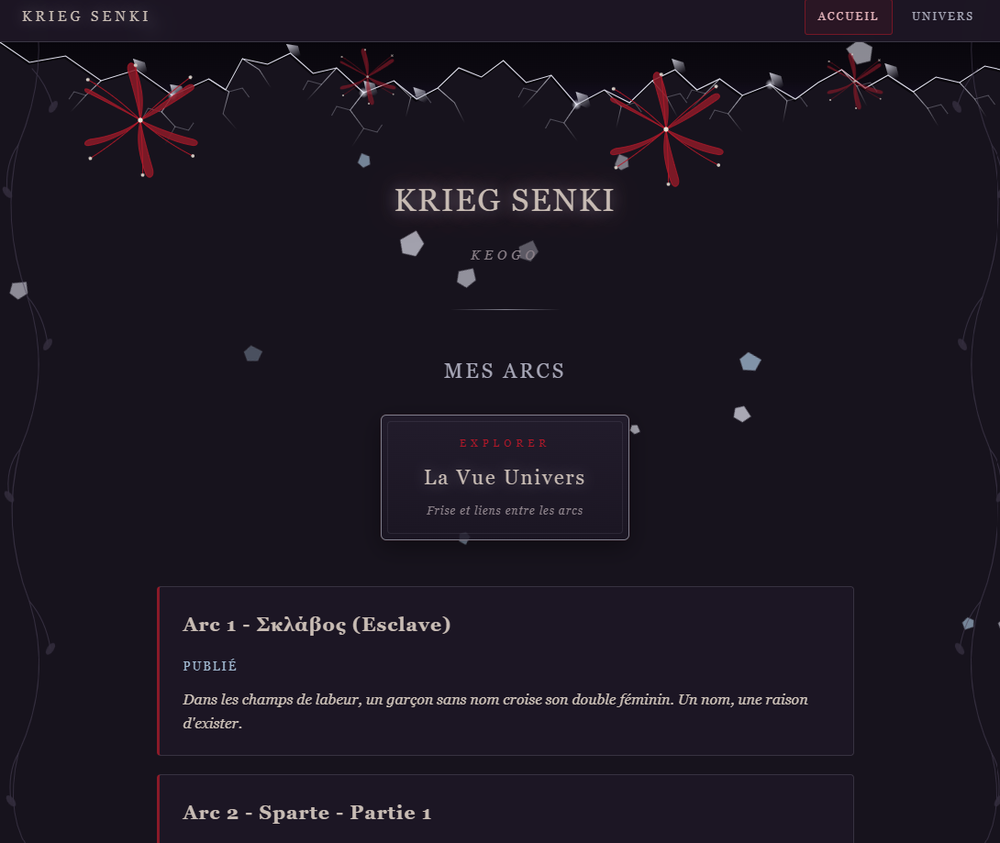
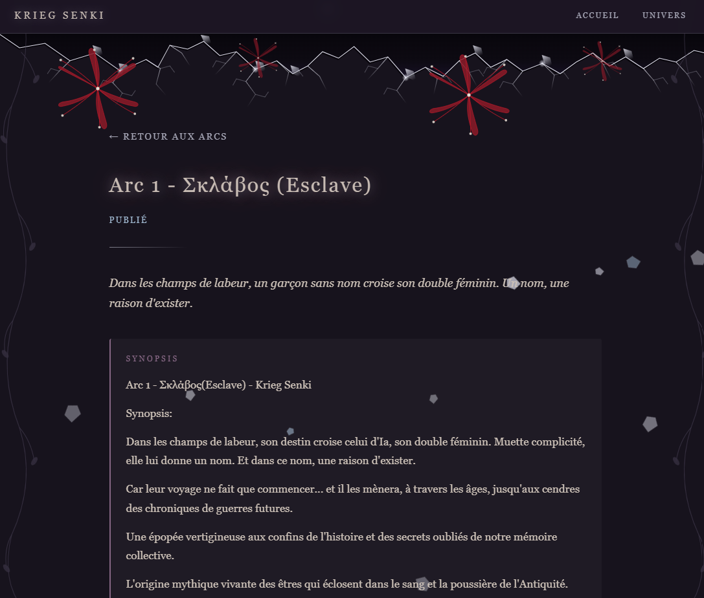
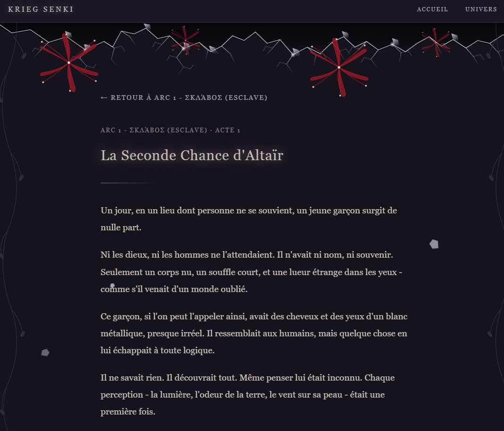
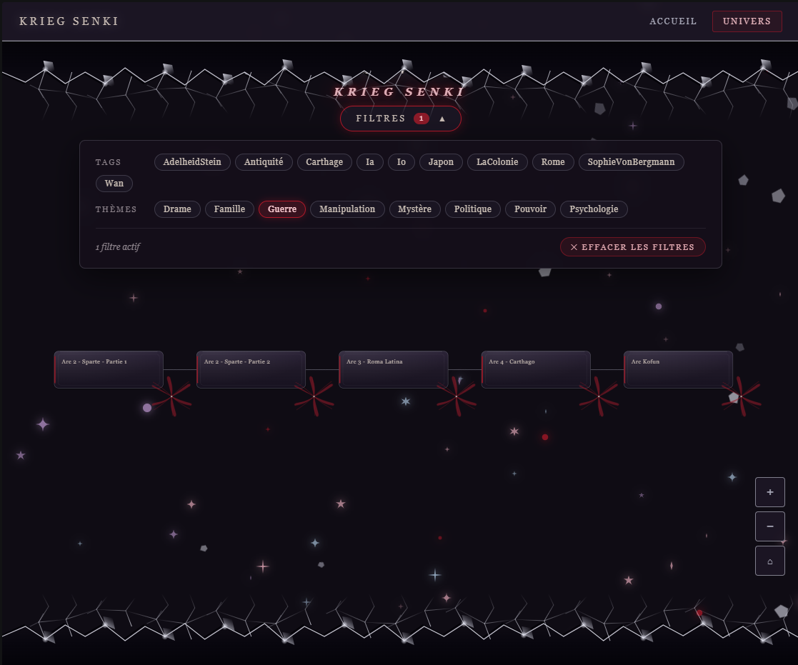
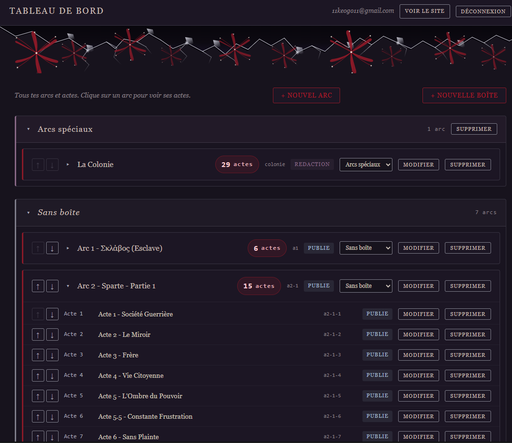
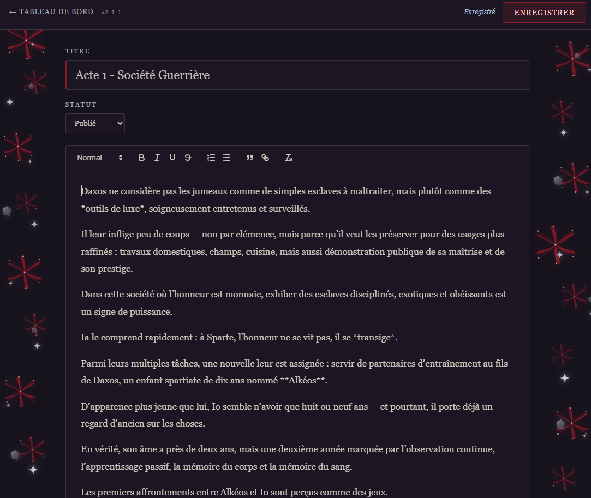

# Krieg Senki

> Plateforme personnelle d'écriture et de lecture pour un univers romanesque.

**Krieg Senki** est un site web conçu pour héberger, organiser et partager une vaste franchise personnelle : des centaines d'arcs narratifs, reliés entre eux par une chronologie, des lieux, des personnages et des thèmes.

Le site est entièrement gratuit, sans framework, sans build, et repose sur des outils open source.

**Site en ligne :** [kriegsenki.keogo.workers.dev](https://kriegsenki.keogo.workers.dev)

---

## ✦ Fonctionnalités

### Côté public

- **Accueil** — liste des arcs publiés avec leur description courte
- **Page d'arc** — synopsis long, liste des actes, navigation
- **Page d'acte** — texte complet, boutons acte précédent / suivant
- **Vue Univers** — arbre généalogique des arcs avec pan, zoom et pinch
- **Filtres** par tag et thème, déroulables et cumulables
- **Liens entre arcs** — au survol, voir tous les arcs qui partagent un tag
- **Confort de lecture** — mode sombre, typographie soignée, responsive téléphone

### Côté admin

- **Connexion sécurisée** via Supabase Auth
- **Tableau de bord** — liste complète des arcs et actes, repliable
- **Édition d'actes** avec éditeur visuel Quill (gras, italique, titres, listes, citations, liens)
- **Création** d'arcs et d'actes depuis le navigateur, sur PC et téléphone
- **Réordonnancement** par boutons ↑ ↓
- **Rangement** dans des boîtes nommées
- **Trois statuts** : publié, rédaction, brouillon — les brouillons sont invisibles en public
- **Import** de fichiers `.txt` par script Python (découpage automatique des actes)
- **Sauvegarde** locale de la base en JSON

---

## ✦ Captures d'écran

### Accueil

### Page d'arc

### Page de lecture d'un acte

### Vue Univers — arbre des arcs

### Tableau de bord admin

### Ecriture Admin

---

## ✦ Stack technique

| Élément | Choix | Pourquoi |
|---|---|---|
| **Frontend** | HTML, CSS, JS vanilla | Zéro build, facile à débugger, durable |
| **Base de données** | Supabase (PostgreSQL + Auth + RLS) | Gratuit, sécurisé, accessible partout |
| **Éditeur** | Quill | Open source, léger, marche bien sur mobile |
| **Hébergement** | Cloudflare Pages | Gratuit, pas de limite de crédits |
| **Scripts locaux** | Python 3 | Pour l'import et la sauvegarde |
| **Versionnement** | Git + GitHub | Sauvegarde et historique |

Aucun framework, aucune dépendance payante, aucun compte à créer pour les visiteurs.

---

## ✦ Structure du projet

kriegsenki/
├── index.html # Accueil public
├── arc.html # Page d'un arc
├── acte.html # Page de lecture d'un acte
├── univers.html # Vue Univers (arbre + filtres)
├── admin.html # Connexion admin
├── dashboard.html # Tableau de bord admin
├── editer-arc.html # Édition d'un arc
├── editer-acte.html # Édition d'un acte (éditeur Quill)
│
├── data/
│ ├── config.js # URL et clé publique Supabase
│ ├── api.js # Fonctions d'accès aux données
│ └── nav.js # Menu de navigation global
│
├── importer.py # Import de .txt vers Supabase
├── sauvegarde.py # Export de la base en JSON
├── analyser.py # Outil de diagnostic d'import
└── README.md

---

## ✦ Démarrage local

Pour lancer le site sur ton propre ordinateur :

1. Clone ce dépôt
2. Ouvre le dossier dans VS Code
3. Installe l'extension **Live Server**
4. Clic droit sur `index.html` → **Open with Live Server**

L'accès admin nécessite un compte Supabase avec les droits correspondants (voir les règles RLS dans le projet Supabase).

---

## ✦ Méthodologie

Ce projet suit une règle simple, appliquée sans exception :

> Un petit pas fiable vaut mieux qu'un grand pas ambitieux.

Chaque étape est petite, testable en moins d'une minute, et commitée avant de passer à la suivante. Aucun outil n'est supposé connu, aucune étape n'est sautée, aucun code partiel n'est livré sans contexte.

---

## ✦ Auteur

**Keogo811** — écriture, développement, design.

---

*Krieg Senki est un projet personnel. Les textes, personnages et univers présentés sont protégés par le droit d'auteur. Le code lui peut être reutiliser si une notice est donné dans le code modifié, et un message à l'auteur.*